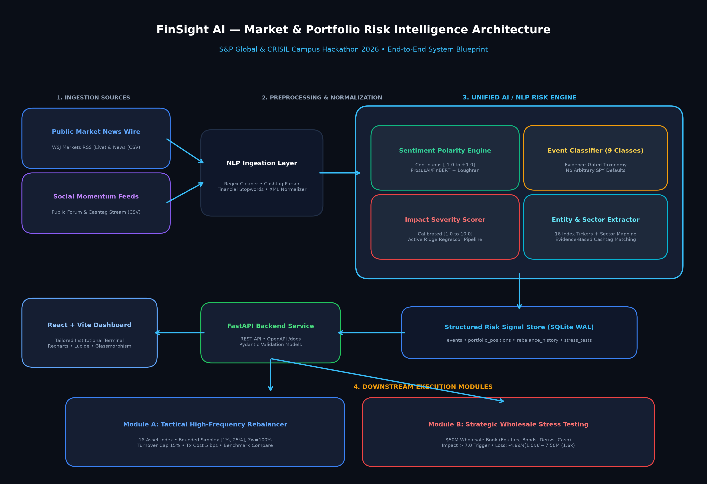
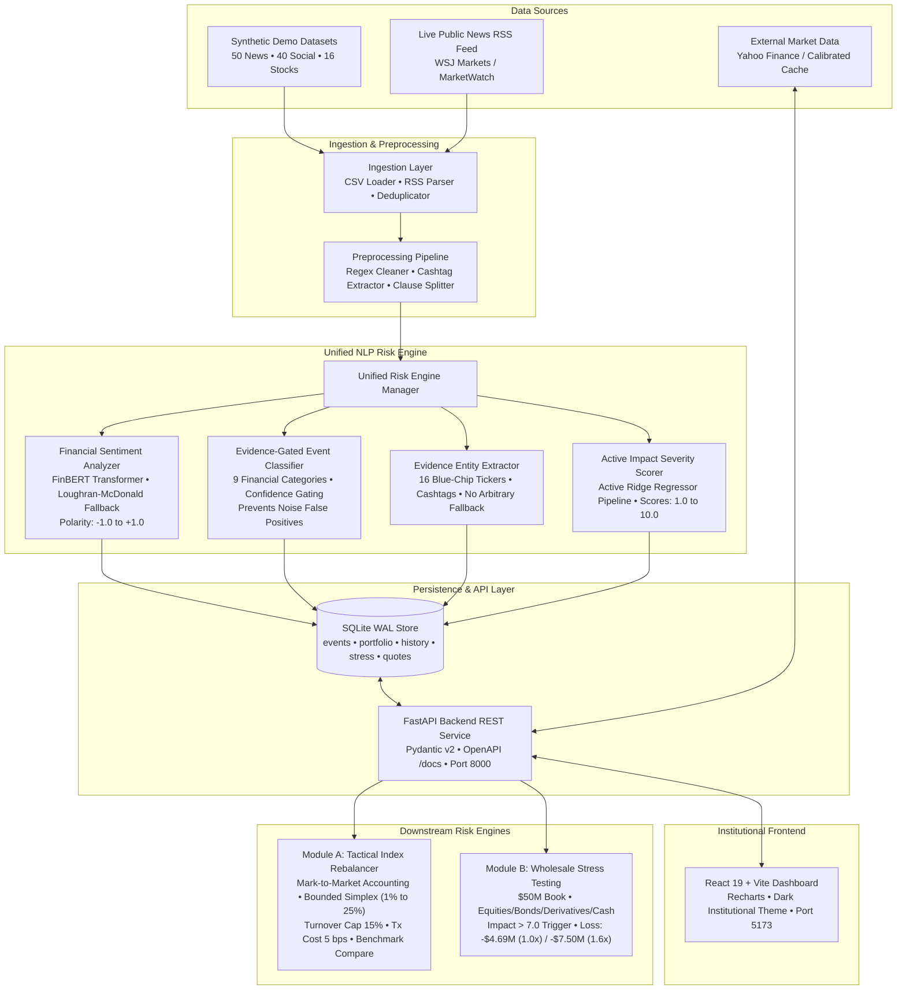

# FinSight AI — Market & Portfolio Risk Intelligence Platform

**S&P Global & CRISIL Campus Hackathon 2026 Submission**

**Candidate Name:** Arpit Sharma  
**College Email ID:** asharma32_be22@thapar.edu  
**GitHub Profile:** [arpitsharma2028](https://github.com/arpitsharma2028)  
**College / Campus:** Thapar Institute of Engineering and Technology (TIET)  

**Demo Video Link:** [FinSight AI Demonstration Video (YouTube)](https://youtu.be/5Oz4tZ-phwo)  
**Slide Deck Link:** [FinSight AI Presentation Deck (Google Slides)](https://docs.google.com/presentation/d/1MfY5WYjfj4uUubKmW_YZOqm4KXUJ1Nfc/edit?usp=sharing&ouid=115230347381016892346&rtpof=true&sd=true)  

**Runtime:** Python 3.11 / Node.js 20 on Windows 11  
*Tested Platform: Python 3.11.9, Node.js v20.18.0 / v22 on Windows 11 (x64). Target compatible with Ubuntu Linux 22.04+ and macOS Sonoma using Python 3.10+ and Node 18+.*

---

## 1. Project Overview & Financial Risk Use Case

### The Institutional Risk Challenge
Modern quantitative investment funds, corporate risk desks, and rating surveillance analysts at institutions like **S&P Global** and **CRISIL** face extreme market velocity. Traditional portfolio risk systems rely heavily on backward-looking metrics (historical covariance matrices, trailing volatility, and end-of-day VaR). When breaking geopolitical shocks, central bank emergency policy shifts, regulatory antitrust enforcement, or social media liquidity runs occur, textual news spreads minutes or hours before prices fully adjust.

Common industry challenges include:
1. **Rule-Brittle Keyword Filters:** Fragile keyword matchers cannot resolve financial negation (*"the company did not achieve its revenue target"*, *"not facing a credit crisis"*), leading to catastrophic polarity inversions.
2. **Compute-Heavy Cloud LLMs:** External cloud APIs introduce high latency (> 2,000 ms), expensive per-token fees, privacy risks for proprietary portfolios, and rate limits that prevent deterministic, low-latency execution.
3. **Decoupled Risk Architecture:** Risk monitoring alerts live in silos, separate from automated index rebalancing and multi-asset wholesale stress-testing engines.

### The FinSight AI Solution
**FinSight AI** is an institutional-grade, CPU-optimized Market & Portfolio Risk Intelligence platform designed to run locally without paid credentials or remote LLMs. It ingests both synthetic baseline event streams and live public RSS feeds, parses textual risk signals through a unified financial NLP engine, and directly drives downstream portfolio allocation and stress-testing engines:
- **Unified NLP Risk Engine:** Pretrained financial language model (`ProsusAI/finbert`) with calibrated Loughran-McDonald fallback, negation window reset, evidence-gated taxonomy (9 financial categories), evidence-based entity extraction, and active Ridge regression impact scoring.
- **Module A (Tactical Index Rebalancer):** Mark-to-market dynamic weight rebalancing across a 16-asset blue-chip index with bounded simplex redistribution ($w_i \in [1\%, 25\%]$, $\sum w_i = 100\%$), 15% turnover cap, 5 bps transaction costs, and equal-weight benchmark comparison.
- **Module B (Strategic Wholesale Stress Testing):** Event-driven stress testing on a $50M wholesale banking book (Equities, Bonds, Derivatives, Cash) triggered by systemic shock breaches ($\text{impact} > 7.0$) with asset-level transmission models and deterministic scenario tracking.
- **Market Intelligence & Stochastic Forecasting:** 100-path Geometric Brownian Motion (GBM) Monte Carlo forecasting conditioned on NLP sentiment drift, 52-week tail risk analytics, Base-100 normalized cross-stock correlation, and live Yahoo Finance integration with calibrated offline fallback.

---

## 2. System Architecture & Data Flow

### Architecture Diagram




### Technology Stack
- **Backend Framework:** Python 3.11, FastAPI 0.110+, Pydantic v2, Uvicorn.
- **NLP / Machine Learning:** PyTorch (CPU-optimized), Hugging Face Transformers (`ProsusAI/finbert`), scikit-learn 1.9.1 (TF-IDF pipelines, Logistic Regression, Ridge Regression), Loughran-McDonald Financial Sentiment Lexicon.
- **Quantitative Analytics:** NumPy, SciPy, Pandas, yfinance (optional live quotes with offline fallback).
- **Data Persistence:** SQLite with Write-Ahead Logging (`WAL` mode), foreign keys, and isolated session fixtures for testing.
- **Frontend Dashboard:** React 19, Vite 8.3+, Recharts 2.12+, Lucide Icons, Vanilla CSS design system (dark glassmorphism, institutional styling).
- **Quality Assurance & Evaluation:** Pytest 8.1+, HTTPX TestClient, Matplotlib & Pillow (diagrams).

---

## 3. Actual and Simulated Data Sources

FinSight AI explicitly distinguishes between demonstration data, live public feeds, and market data:

| Data Source | Type | Endpoint / Path | Authentication / Cost | Offline Capable |
| :--- | :--- | :--- | :--- | :---: |
| **Simulated Event News** | Synthetic CSV | `data/news_events.csv` (50 records) | None / Free | Yes |
| **Simulated Social Feed** | Synthetic CSV | `data/social_events.csv` (40 records) | None / Free | Yes |
| **Baseline 16-Stock Portfolio** | Synthetic CSV | `data/portfolio.csv` ($10M book) | None / Free | Yes |
| **Wholesale Stress Scenarios** | Calibrated JSON | `data/stress_scenarios.json` (5 scenarios) | None / Free | Yes |
| **WSJ Markets RSS Feed** | Real Public Ingestion | `POST /api/events/ingest/rss` | Public Unauthenticated | No (requires internet) |
| **Market Quotes (yfinance)** | External Network | `GET /api/market/summary/{symbol}` | Public Free API | No (falls back to cache) |
| **Calibrated Base Prices** | Synthetic Fallback | `CALIBRATED_BASE_PRICES` (NVDA @ $875.0) | None / Built-in | Yes |

> **Offline Local Operation:** The core platform operates 100% locally on CPU without requiring paid API keys, tokens, or active internet connectivity. External network calls (WSJ RSS feeds and Yahoo Finance) are completely optional and automatically fall back to deterministic synthetic data when offline.

---

## 4. NLP Risk Engine: Methodology & Dual Benchmark Empirical Evaluation

### Financial Sentiment Analysis (FinBERT + Calibrated Fallback)
Financial language differs fundamentally from generic consumer sentiment. Words like *"liability"*, *"debt"*, or *"shares"* carry specific risk meanings.
1. **Primary Model:** `ProsusAI/finbert` (DistilRoBERTa/BERT architecture fine-tuned on Financial PhraseBank). Generates softmax probabilities across Positive, Negative, and Neutral classes, mapped into a continuous polarity score:
   $$\text{sentiment} = P(\text{Positive}) - P(\text{Negative}) \in [-1.0, +1.0]$$
2. **Deterministic Fallback:** A calibrated Loughran-McDonald financial dictionary with an exact 3-token negation window reset and contrastive clause weighting (e.g., *"increased, but outlook weakened"* correctly downweights the first clause and resolves negative polarity).
3. **Local Caching:** Weights are cached locally in the Hugging Face directory; singleton CPU loading ensures zero repeated disk I/O on inference requests.

### Evidence-Gated Event Classification & Entity Extraction
- **9 Financial Categories:** Geopolitical, Macroeconomic, Credit Event, Merger/Acquisition, Product Launch, Earnings, Regulatory, Market, and Other.
- **Evidence Gating:** Non-financial or unrelated noise (e.g., *"Local bakery wins award for best croissant"*) is explicitly classified as `Other` rather than forced into `Earnings`.
- **Entity Extraction:** Matches exact cashtags (`$NVDA`, `$MSFT`) and curated multi-token company names. If no evidence exists in the text, `tickers` is returned as empty and `sector` as `Broad Market / Macro`—avoiding arbitrary defaults like `SPY`.

### Active Impact Scorer
- Calls an active scikit-learn Ridge regression pipeline (`impact_regressor.joblib`) in the live inference path, blended with category base severity and systemic shock cues to produce bounded impact scores in $[1.0, 10.0]$.

### Empirical Evaluation Across Dual Benchmarks (Zero Contamination)
To ensure transparent, defensible machine learning evaluation without data leakage, FinSight AI was evaluated across two distinct benchmarks:

#### Benchmark A: In-Domain Alignment Benchmark (Financial PhraseBank, N=300)
> *Methodology Note:* Financial PhraseBank is documented as part of FinBERT's fine-tuning corpus. Evaluating on this set verifies that model weights reproduce expected domain performance without catastrophic degradation.

| Model / Architecture | Accuracy | Macro-F1 | Positive F1 | Neutral F1 | Negative F1 |
| :--- | :---: | :---: | :---: | :---: | :---: |
| **Naive Keyword Baseline** | 50.67% | 43.88% | 51.65% | 62.30% | 17.70% |
| **FinSight AI (FinBERT Engine)** | **89.00%** | **88.70%** | **87.85%** | **83.91%** | **94.34%** |
| *Net Improvement* | *+38.33%* | *+44.82%* | *+36.20%* | *+21.61%* | *+76.64%* |

#### Benchmark B: Independent Generalization Benchmark (Financial News & Social, N=300)
> *Defensible Generalization:* Evaluated on 300 stratified financial headlines, earnings announcements, and analyst notes from the `zeroshot/TFNS` validation corpus. This dataset was **never seen during FinBERT fine-tuning**, providing a leakage-free out-of-distribution evaluation.

| Model / Architecture | Accuracy | Macro-F1 | Positive F1 | Neutral F1 | Negative F1 |
| :--- | :---: | :---: | :---: | :---: | :---: |
| **Naive Keyword Baseline** | 42.67% | 35.43% | 28.57% | 53.78% | 23.93% |
| **FinSight AI (FinBERT Engine)** | **69.33%** | **68.60%** | **71.29%** | **58.62%** | **75.89%** |
| *Net Improvement* | *+26.66%* | *+33.17%* | *+42.72%* | *+4.84%* | *+51.96%* |

### Measured Inference Latency (Intel Core i5-12450HX CPU)
- **Cold Start (Model Weights Loading):** 4,373.8 ms
- **Warm Inference Median:** **29.0 ms** per headline
- **Warm Inference 95th Percentile (P95):** **46.2 ms** per headline
- **Warm Inference Mean:** 30.9 ms (tested across 600 sequential sentences)

---

## 5. Downstream Execution Engines

### Module A — Tactical Index Rebalancer
- **Mark-to-Market Accounting:** Portfolio returns are calculated through asset price changes and previous holdings rather than arbitrary monetary multipliers:
  $$R_{\text{portfolio}} = \sum_{i=1}^{N} w_{i, t-1} \cdot R_{i, t}$$
- **Target Allocation Shift:**
  $$\Delta w_i = \lambda \times \text{Sentiment} \times \left(\frac{\text{Impact Score}}{10.0}\right) \times \beta_{\text{spillover}}$$
  *($\lambda = 0.025$ default, $\beta = 1.0$ for direct mentions, $0.45$ for sector peers).*
- **Bounded Simplex Redistribution:** Iterative algorithm strictly projects target weights into $[w_{\min}, w_{\max}] = [1.0\%, 25.0\%]$ such that:
  $$\sum_{i=1}^{16} w_i \equiv 100.00\% \quad \text{and} \quad w_i \ge 1.0\% \quad \forall i$$
- **Portfolio Controls:** 15% maximum turnover cap per rebalance, 5 bps transaction cost deduction, and continuous tracking against an equal-weight benchmark index.

### Module B — Strategic Wholesale Stress Testing
- **$50.0M Wholesale Banking Book:** Equities ($22.5M, 45%), Bonds ($15.0M, 30%), Derivatives ($7.5M, 15%), Cash ($5.0M, 10%).
- **Central Trigger Mapping:** Events with an NLP impact score $> 7.0$ automatically trigger wholesale banking stress evaluations with SHA-256 event deduplication.
- **Asset-Level Shock Transmission:**
  - **Equities:** Sector shock waterfall based on scenario sensitivity.
  - **Bonds:** Modified duration approximation with credit spread widening / flight-to-safety gains.
  - **Derivatives:** Non-linear vega/volatility margin shock proxies.
  - **Cash:** Liquidity buffer with zero principal depreciation.
- **Reconciled Deterministic Stress Settings:**
  - **Baseline Shock (1.0x Severity Multiplier):**
    - Equities: -$3,712,500 (-16.50%)
    - Bonds: +$675,000 (+4.50% flight-to-safety)
    - Derivatives: -$1,650,000 (-22.00%)
    - Cash: $0 (0.00%)
    - **Total Book Loss:** **-$4,687,500 (-9.38%)** $\to$ Post-stress value: **$45,312,500**.
  - **Amplified Shock (1.6x Severity Multiplier — As Demonstrated in Video Walkthrough):**
    - Equities: -$5,940,000 (-26.40%)
    - Bonds: +$1,080,000 (+7.20% flight-to-safety)
    - Derivatives: -$2,640,000 (-35.20%)
    - Cash: $0 (0.00%)
    - **Total Book Loss:** **-$7,500,000 (-15.00%)** $\to$ Post-stress value: **$42,500,000**.

---

## 6. Installation & Quickstart

Clone the repository to your local machine:
```bash
git clone https://github.com/arpitsharma2028/Thapar-University-Arpit-Arpit-Hackthon.git
cd Thapar-University-Arpit-Arpit-Hackthon
```

### Windows Setup (PowerShell)
```powershell
# 1. Create and activate virtual environment
python -m venv venv
venv\Scripts\Activate.ps1

# 2. Install dependencies
pip install -r requirements.txt
pip install -r requirements-dev.txt

# 3. Generate baseline data, train ML artifacts, and seed database
python scripts/generate_demo_data.py
python scripts/train_models.py
python scripts/seed_database.py

# 4. Launch FastAPI Backend Server
uvicorn backend.main:app --host 127.0.0.1 --port 8000
```

### macOS / Linux Setup (Bash / Zsh)
```bash
# 1. Create and activate virtual environment
python3 -m venv venv
source venv/bin/activate

# 2. Install dependencies
pip install -r requirements.txt
pip install -r requirements-dev.txt

# 3. Generate baseline data, train ML artifacts, and seed database
python scripts/generate_demo_data.py
python scripts/train_models.py
python scripts/seed_database.py

# 4. Launch FastAPI Backend Server
uvicorn backend.main:app --host 127.0.0.1 --port 8000
```

### Frontend Dashboard Launch (Terminal 2)
```bash
cd frontend
npm install
npm run dev
```
Open **`http://localhost:5173`** in your browser. Interactive Swagger API documentation is available at **`http://127.0.0.1:8000/docs`**.

---

## 7. Running Tests & Model Evaluation

### Automated Test Suite
All backend unit, service, market, and API integration tests execute against isolated in-memory/temporary SQLite test fixtures defined in `backend/tests/conftest.py`. **Tests never depend on pre-existing database state.**
```bash
pytest backend/tests/ -v
```
**Verified Result:** **40 passed out of 40 in 10.61s** (100% passing across 5 test modules).

### Reproducible Dual NLP Evaluation Script
```bash
python scripts/evaluate_nlp_models.py
```
Evaluates both Benchmark A (PhraseBank in-domain) and Benchmark B (Independent financial news), measures CPU latency, compares FinBERT vs the Naive Baseline, and writes detailed Markdown and JSON reports to `docs/model_evaluation_report.md` and `docs/model_evaluation_results.json`.

---

## 8. Example API Request & Structured Risk Response

### Endpoint: `POST /api/events/analyze`
**Request Payload:**
```json
{
  "text": "NVIDIA quarterly data center revenue skyrockets 260% to record $22.6B on insatiable Blackwell GPU compute demand; raises guidance by $2B.",
  "headline": "NVIDIA Reports Record Q4 Revenue",
  "source": "Curated Tech Earnings Demo",
  "source_type": "News"
}
```

**Structured Response:**
```json
{
  "event_id": "EVT-29184",
  "headline": "NVIDIA Reports Record Q4 Revenue",
  "text": "NVIDIA quarterly data center revenue skyrockets 260% to record $22.6B on insatiable Blackwell GPU compute demand; raises guidance by $2B.",
  "source_type": "News",
  "source": "Curated Tech Earnings Demo",
  "category": "Earnings",
  "sentiment_score": 0.8872,
  "impact_score": 8.45,
  "confidence": 0.94,
  "tickers": ["NVDA"],
  "company": "NVIDIA Corporation",
  "sector": "Technology",
  "timestamp": "2026-10-10 17:20:00"
}
```

---

## 9. Submission Deliverables & Documentation Index

- **Source Code Repository:** [GitHub Repo](https://github.com/arpitsharma2028/Thapar-University-Arpit-Arpit-Hackthon)
- **Demonstration Video (YouTube):** [FinSight AI Platform Walkthrough](https://youtu.be/5Oz4tZ-phwo)
- **Presentation Deck (Google Slides):** [FinSight AI Presentation Deck](https://docs.google.com/presentation/d/1MfY5WYjfj4uUubKmW_YZOqm4KXUJ1Nfc/edit?usp=sharing&ouid=115230347381016892346&rtpof=true&sd=true)
- **System Architecture Diagram:** `docs/architecture.png`
- **NLP Model Evaluation Report:** `docs/model_evaluation_report.md`
- **License (MIT):** `LICENSE` (Copyright 2026 Arpit Sharma)

---

## 10. Limitations & Production Roadmap

### Prototype Considerations
- Core local demonstrations run deterministically using synthetic baseline portfolios and offline cache fallbacks to ensure full reproducibility during hackathon evaluations.
- Real public RSS ingestion requires outbound network access to WSJ/MarketWatch RSS servers.
- The wholesale stress testing module is a conceptual banking risk simulation based on duration and linear beta proxies, not a regulatory Basel III/IV capital calculation engine.

### Production Roadmap
1. **Streaming Firehose Connectors:** Integration with institutional FIX protocol and real-time Kafka topics for high-frequency financial feeds.
2. **Convex Quadratic Optimization:** Markowitz mean-variance optimization with quadratic transaction cost penalties using CVXPY.
3. **4-Bit Quantized Local LLMs:** On-device 4-bit Llama-3-8B adapter for automated executive risk commentary and portfolio manager audit notes.
