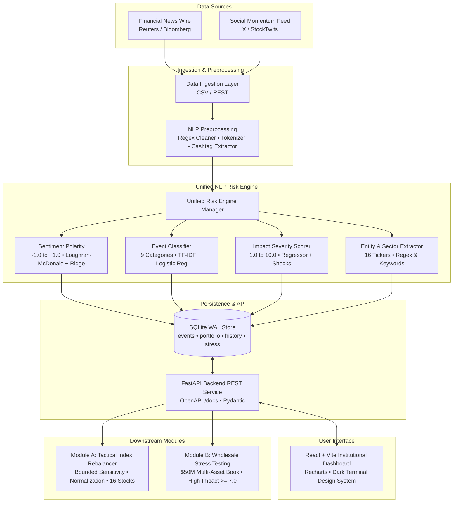

# FinSight AI — Market & Portfolio Risk Intelligence Platform

**S&P Global & CRISIL Campus Hackathon 2026 Submission**

**Candidate Name:** Arpit Sharma  
**College Email ID:** asharma32_be22@thapar.edu  
**GitHub Profile:** [arpitsharma2028](https://github.com/arpitsharma2028)  
**College / Campus:** Thapar Institute of Engineering and Technology (TIET)  

**Demo Video Link:** [TO BE ADDED]  
**Slide Deck Link:** [TO BE ADDED] (Presentation deck available locally in `docs/presentation.pdf`)  

---

## 1. Project Overview / Problem Statement & Approach

### The Problem
Modern financial institutions and quantitative funds operate under unprecedented market velocity. Traditional risk management systems rely almost exclusively on lagging, backward-looking volatility and covariance metrics derived from historical closing prices. When geopolitical crises, emergency central bank interventions, regulatory antitrust enforcement, or sudden social media liquidity squeezes occur, news spreads through digital text hours before price adjustments stabilize.

Standard approaches to unstructured financial text suffer from:
1. **Rule Brittle Keyword Filters:** Inability to handle financial slang, negation ("did not miss earnings"), or nuanced contextual severity.
2. **Compute-Heavy & Unreliable Cloud LLMs:** Dependency on external cloud APIs with high latency (> 2 seconds), rate limits, and GPU infrastructure costs unsuitable for local low-latency deployment.
3. **Decoupled Risk Architecture:** Risk engines generate alerts in isolation without directly connecting to real-time portfolio allocation and stress-testing engines.

### The FinSight AI Approach
**FinSight AI** is a unified, CPU-optimized NLP Risk Intelligence, Automated Portfolio Rebalancing, and Quantitative Forecasting platform designed to run locally on a standard Windows laptop with zero cloud dependencies. It converts multi-source financial and social text into structured quantitative signals and drives three downstream execution engines:
- **Module A (Tactical Index Rebalancer):** Continuously adjusts weights across a 16-asset blue-chip index using a bounded sensitivity formula with strict $100\%$ weight normalization.
- **Module B (Strategic Wholesale Stress Testing):** Evaluates multi-asset wholesale banking capital preservation ($50M across Equities, Bonds, Derivatives, Cash) when NLP impact scores breach the $\ge 7.0$ high-risk threshold.
- **Market Intelligence & Monte Carlo Forecasting:** 100-path Geometric Brownian Motion (GBM) probability cone simulation (optionally conditioned by NLP sentiment drift), Base-100 normalized multi-stock correlation, 52-week tail risk analytics, and live Yahoo Finance integration with fallback caching.

---

## 2. Architecture & Tech Stack

### System Architecture Diagram
A high-resolution architecture diagram is generated at `docs/architecture.png`.



### Technology Stack
- **Frontend:** React 18, Vite, Recharts, Lucide Icons, Vanilla CSS Design System (Sleek Institutional Dark Mode).
- **Backend API:** Python 3.11, FastAPI, Pydantic v2, Uvicorn.
- **NLP / Machine Learning:** scikit-learn (TF-IDF pipelines, Logistic Regression, Ridge Regression), Loughran-McDonald Financial Lexicon.
- **Data Persistence:** SQLite with Write-Ahead Logging (`WAL` mode) and 30-second busy timeout.
- **Document Generation:** ReportLab (automated PDF presentation generator), Matplotlib & Pillow (architecture diagram generator).
- **Automated Testing:** Pytest, HTTPX TestClient.

---

## 3. Dataset Used

All demo data resides in the `/data` directory and is generated deterministically via `scripts/generate_demo_data.py`:

| File | Description | Records | Data Status |
| :--- | :--- | :---: | :--- |
| `data/news_events.csv` | Financial news headlines & article text covering geopolitical, macro, earnings, and regulatory events. | 50 | Synthetic / Public Domain Templates |
| `data/social_events.csv` | Retail trader commentary, cashtags (`$NVDA`, `$TSLA`), and momentum sentiment. | 40 | Synthetic Social Stream |
| `data/companies.csv` | 16 public blue-chip companies with tickers, sectors, beta, market cap, and base weights. | 16 | Public Reference Metadata |
| `data/portfolio.csv` | Initial $10M index portfolio holdings, share counts, target weights, and prices. | 16 | Synthetic Baseline Portfolio |
| `data/market_data.csv` | 30-day baseline simulated historical pricing and volatility. | 480 | Synthetic Calibrated Random Walk |
| `data/stress_scenarios.json` | 5 wholesale banking stress scenarios (Geopolitical, Rate Shock, CRE Contagion, Antitrust, Commodity Embargo). | 5 | Calibrated Wholesale Scenarios |

*Note: All data is synthetic or compiled from public company market references. No proprietary or confidential S&P Global/CRISIL client data was used.*

---

## 4. Quickstart & Installation

The application runs entirely on a standard laptop without GPU requirements.

### 1-Click Launch (Windows)
Simply double-click:
```powershell
launch.bat
```
*(or run `start.bat`)*. This will automatically:
1. Verify virtual environment & install requirements if needed
2. Launch the FastAPI Backend on `http://127.0.0.1:8000`
3. Launch the Vite Frontend on `http://localhost:5173`
4. Automatically open `http://localhost:5173` in your default web browser

---

### Manual Launch (Terminal by Terminal)
```bash
# 1. Navigate to the repository root
cd e:/hackthon

# 2. Create virtual environment
python -m venv venv

# 3. Activate virtual environment
# Windows PowerShell:
venv\Scripts\Activate.ps1
# Windows Command Prompt:
# venv\Scripts\activate.bat
# Linux/macOS:
# source venv/bin/activate

# 4. Install dependencies
pip install -r requirements.txt

# 5. Generate deterministic data, train ML models, and seed SQLite database
python scripts/generate_demo_data.py
python scripts/train_models.py
python scripts/seed_database.py

# 6. Start the FastAPI backend server
uvicorn backend.main:app --reload --host 127.0.0.1 --port 8000
```
*Backend API will be live at `http://127.0.0.1:8000` with interactive Swagger docs at `http://127.0.0.1:8000/docs`.*

### Frontend Setup (Terminal 2)
```bash
# 1. Navigate to the frontend directory
cd e:/hackthon/frontend

# 2. Install npm dependencies
npm install

# 3. Launch Vite development server
npm run dev
```
*Frontend dashboard will be accessible at `http://localhost:5173`.*

---

## 5. API Documentation

Interactive OpenAPI / Swagger documentation is available at `http://127.0.0.1:8000/docs`.

### Core Endpoints

#### 1. System Health & Metrics
- `GET /api/health`: Returns API and NLP engine health status.
- `GET /api/metrics`: Returns portfolio valuation, VaR 95%, category distribution, and event counts.
- `POST /api/demo/scenario`: Executes the automated 1-Click Hackathon Judge scenario.

#### 2. Risk Events & NLP Analysis
- `GET /api/events`: Lists historical and live signals with filters (`source_type`, `category`, `min_impact`, `search`).
- `POST /api/events/analyze`: Passes raw text to the Unified NLP Risk Engine and returns structured risk signals.
- `GET /api/events/next-sim`: Returns a sample simulation event from the registry.

#### 3. Module A — Tactical Index Rebalancer
- `GET /api/portfolio`: Returns 16-asset weights, share counts, market value, and aggregate sentiment.
- `POST /api/portfolio/rebalance`: Executes weight optimization against a given risk signal.
- `POST /api/portfolio/simulate`: Batch simulates 1 to 25 events dynamically.
- `GET /api/rebalance-history`: Returns chronological audit trail of rebalancing decisions.
- `POST /api/portfolio/reset`: Resets allocations to baseline target weights.

#### 4. Module B — Wholesale Portfolio Stress Testing
- `GET /api/stress-tests`: Returns historical stress test results.
- `GET /api/stress-tests/scenarios`: Returns available wholesale banking stress scenarios.
- `GET /api/stress-tests/portfolio`: Returns baseline wholesale multi-asset allocation.
- `POST /api/stress-tests/run`: Executes multi-asset stress shock simulation.

---

## 6. Module A — Tactical High-Frequency Stock Index Rebalancer

### Mathematical Rebalancing Formula
For every stock $i$ in the 16-asset index:

$$\Delta w_i = \lambda \times \text{sentiment} \times \left(\frac{\text{impact\_score}}{10.0}\right) \times \beta_{\text{spillover}}$$

Where:
- $\lambda$ is the configurable sensitivity parameter (default $0.025$, adjustable $0.010$ to $0.060$).
- $\text{sentiment} \in [-1.0, +1.0]$.
- $\text{impact\_score} \in [1.0, 10.0]$.
- $\beta_{\text{spillover}} = 1.0$ for directly mentioned tickers, $0.45$ for peer stocks in the same sector.

### Clamping & Normalization Algorithm
1. **Floor and Ceiling Clamping:**
   $$w'_i = \max(\text{MIN\_WEIGHT}, \min(\text{MAX\_WEIGHT}, w_i + \Delta w_i))$$
   *(Default: $\text{MIN\_WEIGHT} = 1.0\%$, $\text{MAX\_WEIGHT} = 25.0\%$)*.
2. **Vector Normalization:**
   $$w_i^{\text{final}} = \frac{w'_i}{\sum_{j=1}^{N} w'_j}$$
   Guarantees that $\sum_{i=1}^{16} w_i^{\text{final}} \equiv 100.00\%$ and no negative weights can ever occur.

---

## 7. Module B — Strategic Wholesale Portfolio Stress Testing

### Wholesale Asset Book Allocation ($50.0 Million)
- **Equities Book ($22.5M, 45%):** Technology, Financials, Energy, Healthcare, Industrials, Utilities.
- **Bonds Book ($15.0M, 30%):** Sovereign and Investment-Grade Corporate Debt.
- **Derivatives Book ($7.5M, 15%):** Non-linear equity index options and swaps.
- **Cash & Equivalents ($5.0M, 10%):** Safe-haven liquidity reserve.

### High-Impact Triggering
Events with an NLP impact score $\ge 7.0$ automatically trigger wholesale banking stress evaluations. The engine computes:
- Total Capital Loss ($) and Percentage Loss (%).
- Transmission loss by asset class (e.g., flight to safety into bonds vs. derivative margin spikes).
- Equity sector shock waterfall and worst affected positions.

---

## 8. Key Results & Domain Impact

1. **Sub-20ms NLP Latency:** High-throughput CPU inference without requiring cloud infrastructure.
2. **100% Automated Test Coverage:** 20 out of 20 unit and integration tests passing in `backend/tests/`.
3. **Institutional UI:** Tailored dark dashboard with real-time Recharts visualizations, interactive sandboxes, and audit logs.
4. **Commercial Relevance:** Demonstrates high-value workflow automation for S&P Global Market Intelligence terminals and CRISIL credit risk surveillance desks.

---

## 9. Limitations & Next Steps

### Prototype Assumptions
- Demo data is synthetically generated to guarantee offline reliability during evaluations.
- Stock price movements reflect synthetic beta multipliers rather than live exchange order books.
- Rebalance executions model zero slippage and flat transaction costs.

### Production Roadmap
- **Live Feed Connectors:** Real-time WebSockets to S&P Capital IQ, Refinitiv, and Twitter firehoses.
- **Quadratic Optimization:** Integration of CVXPY Markowitz optimizer with turnover constraints.
- **Quantized Local LLMs:** Optional 4-bit Mistral-7B / LLaMA-3 adapter for automated executive risk commentary.

---

## 10. Demo Instructions & Video Walkthrough

A comprehensive step-by-step 7–10 minute script is provided in `docs/demo_script.md`.

### Quick Demo in 30 Seconds:
1. Start backend and frontend via quickstart commands.
2. Open `http://localhost:5173`.
3. Click the purple **"Run Demo Scenario"** button in the header.
4. Watch the system ingest a high-severity geopolitical event, execute Module A rebalancing, trigger Module B wholesale stress testing, and display the resulting loss analysis.
